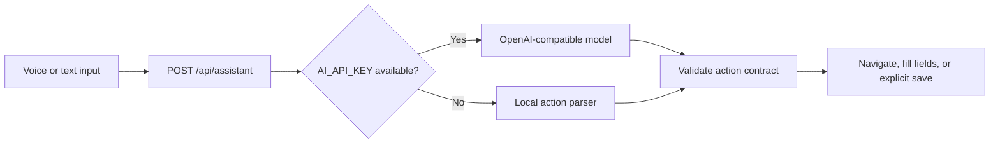
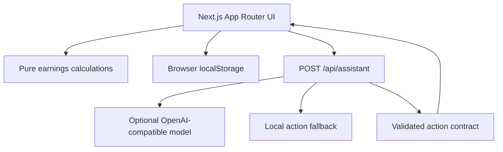

# KamaiClear

> **Know what your shift really pays.**

KamaiClear is a phone-first earnings workspace for delivery riders and other gig workers. It turns a platform payout into a clearer take-home view by separating gross earnings, operating costs, net earnings and true hourly pay.

<p>
  <strong>Current stage:</strong> local-first MVP ·
  <strong>Primary flow:</strong> record → calculate → review → save → share
</p>

<details>
<summary><strong>Contents</strong></summary>

- [What KamaiClear does](#what-kamaiclear-does)
- [60-second product tour](#60-second-product-tour)
- [Quick start](#quick-start)
- [Assistant playground](#assistant-playground)
- [How the calculation works](#how-the-calculation-works)
- [Architecture](#architecture)
- [Configuration](#configuration)
- [Quality checks](#quality-checks)
- [Deployment](#deployment)
- [Privacy and safety](#privacy-and-safety)
- [Project structure](#project-structure)
- [Roadmap](#roadmap)
- [Documentation](#documentation)

</details>

## What KamaiClear does

| Workspace | Purpose |
| --- | --- |
| **Overview** | See net earnings, true hourly pay, cost rate and best recorded shift. |
| **Log a shift** | Capture payout, tips, incentives, hours, distance and operating costs with live calculations. |
| **Shift history** | Filter and compare saved shifts in the current browser. |
| **Net Pay Receipt** | Create a clear, printable record of what a shift actually paid. |
| **KamaiClear Assistant** | Type or speak simple requests to navigate, fill shift fields and review earnings. |

The product is intentionally honest about its current boundary: it works locally with browser storage. Hosted accounts, shared records and authentication are planned, but are not pretending to be connected in this MVP.

## 60-second product tour

1. Start the app and open **Log a shift**.
2. Enter an example shift:
   - Platform: `Zomato`
   - Hours: `8.5`
   - Payout: `1150`
   - Fuel: `240`
   - Maintenance: `60`
3. Review the live net-pay calculation.
4. Save the shift only after checking the values.
5. Open **Shift history** and create the **Net Pay Receipt**.
6. Print or save the receipt as a PDF when a portable record is useful.

> **Tip:** The workspace starts empty. The demo does not seed fake shifts or use platform credentials.

## Quick start

### Requirements

- Node.js 20.9 or newer
- npm 10 or newer
- A modern browser for the best responsive and voice experience

### Install and run

```bash
npm install
npm run dev
```

Open [http://localhost:3000](http://localhost:3000).

### Run the production build locally

```bash
npm run build
npm run start
```

The production server uses port `3000` by default. Use `--port 3100` if another local process is already using it:

```bash
npm run start -- --hostname 127.0.0.1 --port 3100
```

## Assistant playground

The assistant accepts plain-language requests instead of requiring users to know the product vocabulary.

<details>
<summary><strong>Try these text commands</strong></summary>

```text
hi
What did I earn?
Log a shift
Show my history
Open my receipt
I worked 8.5 hours on Zomato, earned 1150, fuel 240 and maintenance 60
Save shift
```

</details>

<details>
<summary><strong>Supported interaction modes</strong></summary>

- Text-to-text assistant replies
- Browser speech-to-text when supported by the device/browser
- Text-to-speech for assistant replies
- Hands-free speech mode
- Multilingual assistant labels and response templates
- Local deterministic fallback when no model key is available

</details>

The request path is deliberately small and validated:



The browser never receives the server-side model key. Ambiguous speech should be reviewed before saving; no honest speech system can guarantee perfect recognition for every device, accent or language.

## How the calculation works

KamaiClear keeps the calculation model explicit and readable in [`src/lib/earnings.ts`](src/lib/earnings.ts):

```text
Gross earnings = payout + tips + incentives
Operating costs = fuel + maintenance + phone/data + other costs
Net earnings = gross earnings - operating costs
True hourly pay = net earnings / recorded hours
```

All displayed money is formatted as Indian Rupees (`INR`). The current MVP treats values as user-provided records; it does not verify platform statements.

## Architecture



### Design boundaries

- `src/lib/earnings.ts` owns calculation rules and shared data types.
- `src/lib/assistant.ts` owns deterministic intents, multilingual response templates and field extraction.
- `src/app/api/assistant/route.ts` owns the optional live model boundary and action validation.
- `src/components/kamaiclear-app.tsx` owns the client workflow and browser persistence.
- `src/components/kamaiclear-logo.tsx` owns the reusable brand mark and wordmark.
- `src/app/globals.css` owns the focused navy, teal and saffron visual system.

## Configuration

The app runs without credentials. To configure optional infrastructure, copy the example file:

**Windows**

```powershell
Copy-Item .env.example .env.local
```

**macOS / Linux**

```bash
cp .env.example .env.local
```

### Optional server-side assistant model

```env
AI_API_KEY=replace-with-a-server-only-key
AI_BASE_URL=https://api.openai.com/v1
AI_MODEL=gpt-4o-mini
```

Keep `.env.local` private. It is ignored by Git and must never be copied into client-side code, documentation, screenshots or commits.

### Reserved future infrastructure

The example file also documents future boundaries for Supabase, Neon, auth, payments and email. They are not required for the current MVP and are intentionally not wired into the user flow yet.

## Quality checks

Run the checks that are currently configured before sharing a build:

```bash
npm run typecheck
npm run build
npm audit --audit-level=high
```

Current verification coverage:

| Check | Status |
| --- | --- |
| TypeScript typecheck | `npm run typecheck` |
| Production build | `npm run build` |
| Dependency audit | `npm audit --audit-level=high` |
| Lint script | Not configured yet |
| Automated test script | Not configured yet |

Manual smoke path:

```text
Open app → Log a shift → watch live calculation → Save → History → Receipt → refresh browser
```

## Deployment

The app is structured for Vercel deployment as a Next.js application.

```bash
npx vercel login
npx vercel --prod
```

Set `AI_API_KEY`, `AI_BASE_URL` and `AI_MODEL` as server-side environment variables in the deployment platform only if live model responses are needed. The deterministic local fallback keeps the core assistant flow usable without those values.

Before a public hosted persistence release, add authentication, a server-backed shift store and row-level access controls. See [`ARCHITECTURE.md`](ARCHITECTURE.md) for the planned boundary.

## Privacy and safety

- Shift records remain in the current browser through `localStorage`.
- No real OTP, Aadhaar number, platform password or payment credential is required by this MVP.
- Do not paste API keys into the assistant or commit them to the repository.
- Treat payout, cost and receipt values as user-entered records, not verified statements.
- Review assistant-filled numbers before saving.
- Voice quality depends on browser, device, microphone, network and language support; typing remains the reliable fallback.

## Project structure

```text
.
├── src/
│   ├── app/
│   │   ├── api/assistant/route.ts   # Optional live model boundary
│   │   ├── globals.css              # Brand tokens and responsive UI
│   │   ├── icon.svg                 # Browser/app icon
│   │   ├── layout.tsx               # Metadata and root layout
│   │   └── page.tsx                 # App entry point
│   ├── components/
│   │   ├── kamaiclear-app.tsx       # Main product workflow
│   │   ├── kamaiclear-assistant.tsx # Voice/text assistant UI
│   │   └── kamaiclear-logo.tsx      # Reusable logo component
│   └── lib/
│       ├── assistant.ts              # Intents, extraction and responses
│       ├── cn.ts                     # Class-name helper
│       └── earnings.ts               # Domain model and calculations
├── public/kamaiclear-logo.svg       # Standalone logo asset
├── index.html                       # Legacy zero-dependency preview
├── ARCHITECTURE.md                  # Hosted architecture plan
├── MVP-DESCRIPTION.txt              # MVP submission summary
└── ROUND-2-SUBMISSION.md            # Round 2 documentation
```

## Roadmap

### Current MVP

- Local-first shift logging
- Transparent net-pay calculation
- Printable Net Pay Receipt
- Voice/text assistant with safe explicit-save behavior
- Responsive phone-first interface

### Next product slice

1. Validate the workflow with at least five riders.
2. Add Supabase Auth and a hosted `shifts` table.
3. Add row-level security and a storage adapter behind the existing `Shift` type.
4. Add automated tests and browser-level regression checks.
5. Add reporting only after real usage justifies it.

## Documentation

- [`ARCHITECTURE.md`](ARCHITECTURE.md) — current boundary, planned hosted stack and security rules
- [`MVP-DESCRIPTION.txt`](MVP-DESCRIPTION.txt) — concise product and submission description
- [`ROUND-2-SUBMISSION.md`](ROUND-2-SUBMISSION.md) — detailed MVP submission document
- [`public/kamaiclear-logo.svg`](public/kamaiclear-logo.svg) — full brand logo asset

---

Built for clearer decisions, not just bigger payout numbers.
